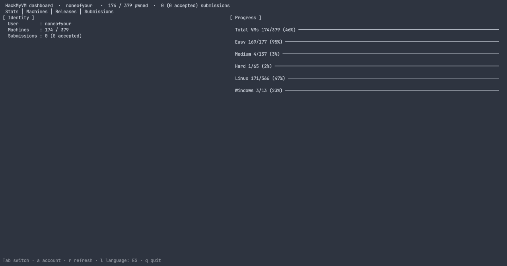
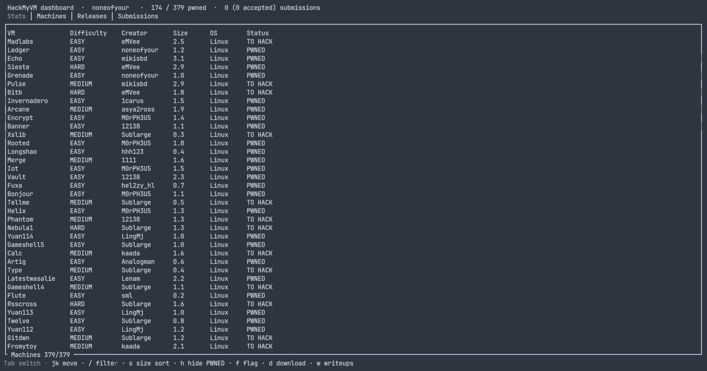
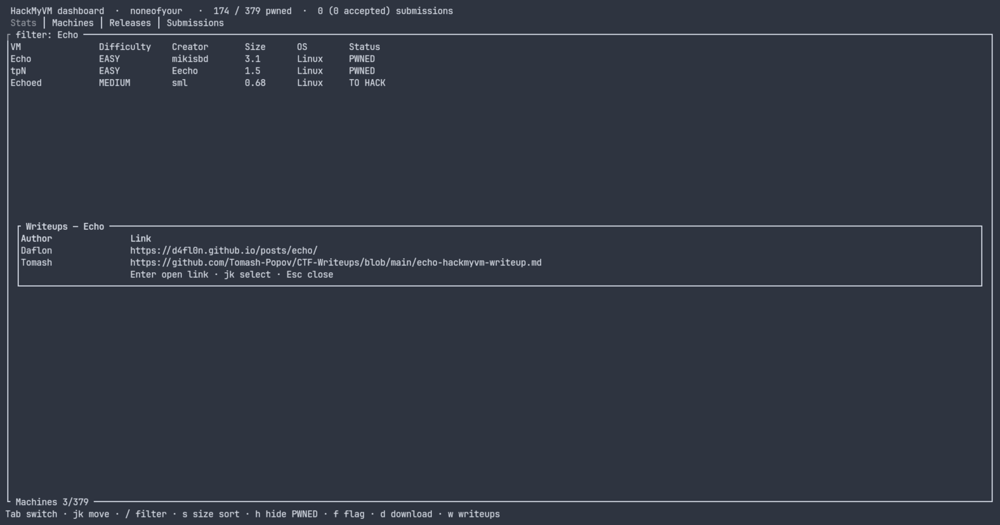
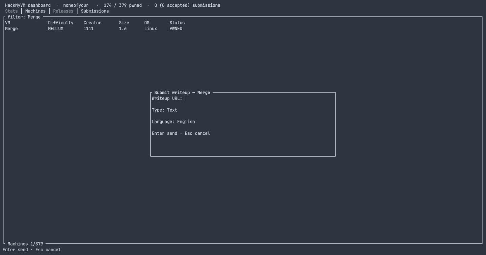
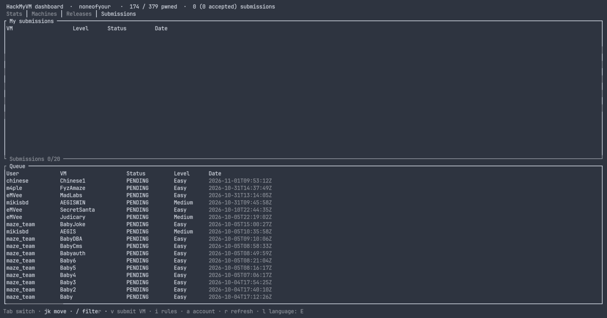
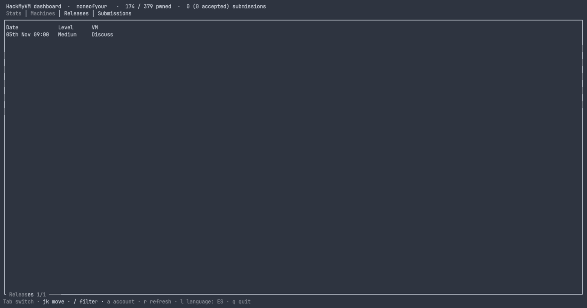

# HMV-TUI

### HackMyVM Advanced Versatile Operations Toolkit

<p><a href="README.md">English</a> · <strong>Español</strong></p>

**HMV-TUI** es un dashboard interactivo para tu terminal de la comunidad de [HackMyVM](https://hackmyvm.eu): explora el catálogo de máquinas, descarga VMs directamente de MEGA, envía flags, lee writeups de la comunidad y publica los tuyos — todo sin salir de la terminal.

Un comando, una pantalla: ejecutar `hmv` abre el dashboard. Escrito en **Rust** puro, distribuido como un binario estático sin dependencias en tiempo de ejecución.



> **v1.2.0** — migrado a la nueva plataforma de HackMyVM: cuatro pestañas (Stats, Machines, Releases, Submissions), catálogo en una sola petición, envío de flags en un único campo y writeups con tipo + idioma. Si usas v1.1.0 o anterior, recompila — esas builds llaman a endpoints retirados y muestran un "Login failed" engañoso.

---

## Características

* **Un solo comando** — `hmv` abre el dashboard: catálogo de máquinas, medidores de progreso, cola de envíos y descargas en una sola pantalla.
* **Gestión de cuenta en la app** — primer arranque, cambio de cuenta y cierre de sesión desde el popup de cuenta (`a`); las credenciales se validan con un login real antes de guardar nada.
* **Auth segura** — la contraseña vive en la bóveda del sistema (Secret Service en Linux, Credential Manager en Windows, Keychain en macOS) vía `keyring`. Solo el usuario y la última carpeta de descargas tocan `~/.hmv/config.json`.
* **Catálogo de máquinas** — 379 máquinas en una sola petición con dificultad en colores (Easy/Medium/Hard), filtrado instantáneo con `/` (nombre, dificultad, creador, estado), ordenación por tamaño (`s`: menor ↔ mayor) y alternador para ocultar PWNED (`h`).
* **Columna de SO** — cada máquina muestra su SO (Linux / Windows) directamente del catálogo.
* **Descargas rápidas** — las VMs fluyen directamente de MEGA, hasta **2 en paralelo** (las demás en cola), descifradas al vuelo (AES-128-CTR) y **verificadas con el MAC por chunks de MEGA** antes de salir del archivo `.part`.
* **Envío de flags** — popup de un solo campo (`f`) cuya respuesta el servidor clasifica como user o root; las máquinas PWNED muestran un recuadro de solo lectura.
* **Writeups** — lee los writeups de la comunidad (`w`) y envía el tuyo (`u`, tipo + idioma + URL) cuando la máquina esté pwned.
* **Envíos** — pestaña dedicada para tus propias VMs: envía una VM (`v`) con un formulario dinámico (nombre, URL de descarga, flags user/root, tags, selector de nivel, notas, writeup), consulta la cola de envíos y lee las normas (`i`).
* **Calendario de releases** — próximas máquinas de HackMyVM con su nivel y fecha.
* **UI bilingüe** — cambia todo el dashboard entre inglés y español con una sola tecla (`l`); la elección se conserva entre sesiones.

---

## Capturas

<div align="center">

| Stats | Machines |
| :---: | :---: |
|  |  |
| **Writeups de la comunidad** | **Envío de writeup** |
|  |  |
| **Envíos** | **Releases** |
|  |  |

</div>

---

## Requisitos previos

* **SO**: Linux (objetivo principal — **desarrollado y probado en Arch Linux**); se proporcionan binarios de release para macOS y Windows.
* Una cuenta activa en [HackMyVM](https://hackmyvm.eu/).
* Un proveedor de Secret Service en Linux (p. ej. GNOME Keyring / KWallet) para almacenar credenciales.

---

## Instalación

### 1. Desde un binario de release (lo más fácil)

Descarga el archivo de tu plataforma desde la página de [Releases](https://github.com/setyanoegraha/hmv-tui/releases), extráelo y pon el binario `hmv` en tu `PATH`:

| Plataforma | Archivo |
| :--- | :--- |
| Linux x86_64 | `hmv-v1.2.0-x86_64-unknown-linux-gnu.tar.gz` |
| macOS Apple Silicon | `hmv-v1.2.0-aarch64-apple-darwin.tar.gz` |
| macOS Intel | `hmv-v1.2.0-x86_64-apple-darwin.tar.gz` |
| Windows x86_64 | `hmv-v1.2.0-x86_64-pc-windows-msvc.zip` |

```bash
tar xzf hmv-v1.2.0-x86_64-unknown-linux-gnu.tar.gz
install -m 755 hmv ~/.local/bin/hmv
```

> **Arch Linux** — HMV-TUI se desarrolla y prueba en Arch. El binario de Linux se compila en Ubuntu, pero funciona en Arch tal cual; solo asegúrate de tener un proveedor de Secret Service:
>
> ```bash
> sudo pacman -S --needed gnome-keyring
> ```

### 2. Desde el código fuente

```bash
git clone https://github.com/setyanoegraha/hmv-tui.git
cd hmv-tui
cargo install --path .
```

### 3. Directamente desde git

```bash
cargo install --git https://github.com/setyanoegraha/hmv-tui.git
```

> Requiere el toolchain de Rust (1.85+): https://rustup.rs

---

## Primer arranque

Nada que configurar a mano — solo ejecuta:

```bash
hmv
```

En la primera ejecución (o cuando la contraseña guardada deje de funcionar) el dashboard abre un popup **Configure HackMyVM**:

1. Escribe tu **usuario** de HackMyVM y pulsa `Tab` / `↓`.
2. Escribe tu **contraseña** (oculta como `•••`) y pulsa `Enter`.

Las credenciales se validan con un login real **antes** de guardar nada. Si el login falla, el popup se vuelve a abrir con tu usuario intacto; `Esc` sale de la app.

---
Cuatro pestañas manejadas por teclado — `Stats`, `Machines`, `Releases` y `Submissions`:

| Teclas | Acción |
| :--- | :--- |
| `Tab` / `←` `→` | Cambiar de pestaña |
| `↑` `↓` / `j` `k` | Mover la selección |
| `g` / `Home` | Ir al inicio de la lista |
| `/` | Filtrar la lista actual (escribe para filtrar, `Enter` lo mantiene, `Esc` limpia y sale) |
| `a` | **Popup de cuenta** — muestra la cuenta activa: `Enter` abre el popup de login para cambiar de cuenta, `l` cierra sesión, `Esc` cierra |
| `l` | **Cambiar idioma de la UI** — inglés ↔ español, en todas partes, se conserva entre sesiones |
| `s` | **Solo Machines** — ciclo de orden por tamaño: orden del sitio → menor primero → mayor primero |
| `h` | **Solo Machines** — alternar ocultar máquinas totalmente PWNED (pulsa otra vez para mostrarlas) |
| `f` | **Solo Machines** — popup de un solo campo: el servidor decide si es la flag user o root. El resultado aparece en un popup (`Flag: ✓ ACEPTADA` / `Flag: ✗ INCORRECTA`) y los datos se refrescan al cerrarlo. Las máquinas PWNED muestran un recuadro de solo lectura. |
| `d` | **Solo Machines** — popup de descarga: elige la carpeta de destino (se recuerda entre sesiones, con autocompletado de rutas `Tab` al estilo zsh), enlace de MEGA resuelto automáticamente y descarga en streaming con progreso en vivo en el overlay de Descargas. Verificado con MAC antes de terminar. |
| `w` | **Solo Machines** — popup de writeups de la comunidad de la máquina seleccionada: `j`/`k` para seleccionar, `Enter` abre el enlace en tu navegador, `Esc` cierra. |
| `u` | **Solo Machines** — envía un writeup para una máquina pwned: URL, tipo (Text/Video) e idioma; `←`/`→` cicla los selects (también con popup de resultado). |
| `v` | **Solo Submissions** — popup de envío de tu VM: nombre, URL de descarga, flags user/root, tags, nivel (`←`/`→` cicla Fácil → Media → Difícil), notas y writeup (ambos opcionales). El servidor valida el envío y su veredicto se muestra en el popup de resultado. |
| `i` | **Solo Submissions** — lee las normas de envío en un popup amplio. |
| `o` | Alternar el overlay de **Descargas** (medidores en vivo, velocidad, rutas finales). Cerrarlo nunca detiene las descargas en curso. |
| `c` | **En el overlay de Descargas** — cancelar la descarga activa más reciente (el `.part` temporal se limpia). |
| `r` | Volver a obtener todos los datos |
| `q` / `Esc` / `Ctrl-C` | Salir — con descargas activas, un popup de confirmación las lista: `Enter` cancela las descargas y sale, `Esc` se queda. |

### Gestión de la cuenta

Pulsa `a` en cualquier parte del dashboard:

- **`Enter` — cambiar de cuenta**: abre el popup de login con el usuario actual precargado. Introduce las nuevas credenciales; se validan con un login real antes de reemplazar la cuenta guardada, y el dashboard se recarga con el nuevo perfil.
- **`l` — cerrar sesión**: borra la contraseña de la bóveda del sistema y el usuario de `~/.hmv/config.json` (tu preferencia de carpeta de descargas se conserva), vacía el dashboard y muestra el popup de login. Inicia sesión con otra cuenta o pulsa `Esc` para salir.
- Las descargas en curso nunca se ven afectadas — usan enlaces públicos de MEGA, no tu sesión.

Las acciones enviadas desde la TUI muestran su veredicto en un popup de resultado que persiste hasta cerrarse (`Flag: ✓ ACEPTADA`, `Flag: ✗ INCORRECTA`, ...) y disparan una actualización automática de datos al cerrarse si tu progreso cambió. La flag enviada es un solo campo: el servidor decide si era la user o la root.

Las descargas corren en segundo plano (máx. 2 en paralelo, las demás en cola): el overlay de Descargas muestra medidores en vivo, velocidad y la ruta final; las descargas siguen aunque cierres el overlay; si sales con descargas activas, se abre un popup de confirmación con la lista (`Enter` cancela y sale, `Esc` se queda).

### Dónde viven tus datos

- `~/.hmv/config.json` — tu usuario, la última carpeta de descargas y el idioma de la UI (`"lang": "en" | "es"`). Nada más.
- Bóveda del sistema — tu contraseña, bajo el servicio `hmv-cli`. Nunca en disco en texto plano.

---

## Actualizar

```bash
cargo install --git https://github.com/setyanoegraha/hmv-tui.git --force
```

o simplemente descarga el último binario desde la página de [Releases](https://github.com/setyanoegraha/hmv-tui/releases).

### Desinstalación y limpieza

```bash
cargo uninstall hmv
```

HMV guarda la configuración en `~/.hmv/` y la contraseña en la bóveda del sistema. Borra la carpeta (y la entrada `hmv-cli` de la bóveda) para eliminar todos los datos locales:
- Linux: `~/.hmv`

---

## Notas de seguridad

* Nunca se envían credenciales de HackMyVM o MEGA a MEGA — las descargas de archivos públicos usan la API anónima de MEGA.
* Los archivos descargados se descifran con AES-CTR en streaming y se verifican contra el MAC de MEGA incrustado en la clave del archivo; las descargas corruptas o interrumpidas se rechazan y nunca dejan un `.zip` parcial.
* Todo el tráfico usa HTTPS (las URLs de almacenamiento de MEGA se actualizan de `http://` a `https://`).

---

## Enlaces oficiales

- Sitio web: [hackmyvm.eu](https://hackmyvm.eu)
- Discord: [Official HackMyVM](https://discord.com/invite/DxDFQrJ)
- Versión Python legacy: [hackmyvm-commandlineinterface](https://github.com/setyanoegraha/hackmyvm-commandlineinterface)

## Agradecimientos

Un agradecimiento enorme y el máximo respeto a la comunidad de HackMyVM, al staff y a todos los creadores de máquinas. Este toolkit existe gracias a la increíble plataforma y comunidad que han construido para que los entusiastas de la ciberseguridad aprendamos, compartamos y crezcamos.

Implementación de criptografía MEGA portada de [mega.py](https://github.com/odwyersoftware/mega.py) (odwyersoftware).

---

## Licencia

MIT — ver [LICENSE](LICENSE).

---

Hecho con ❤️ por [Ouba](https://github.com/setyanoegraha).

*¡Happy Hacking en HackMyVM!*
